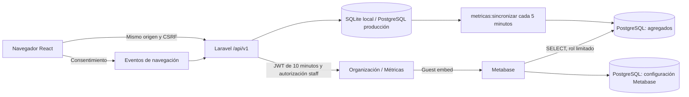

# Arquitectura

## Componentes

NexZone utiliza Laravel 13 y Sanctum en el servidor; React 19, React Router,
TanStack Query y Vite en el navegador. Desarrollo conserva SQLite. La aplicación
publicada utiliza PostgreSQL de Supabase y almacenamiento de imágenes en su bucket
`medios`. Los pagos, premios y retiros son exclusivamente virtuales.

Los eventos se guardan primero en la base operativa. El agregado es una copia
reconstruible. La base de configuración de Metabase conserva usuarios, conexión,
preguntas y dashboard; no debe confundirse con el almacén de indicadores.

## Mapa del código

| Directorio | Responsabilidad |
| --- | --- |
| `backend/app/Enumeraciones` | Juegos, formatos y máquinas de estado |
| `backend/app/Models` | Entidades y relaciones del negocio |
| `backend/app/Policies` | Reglas de acceso a cada entidad |
| `backend/app/Http/Controllers/Api/V1` | Frontera HTTP pública, del jugador y de organización |
| `backend/app/Http/Requests` | Validación de entradas |
| `backend/app/Servicios/Torneos` | Inicio, cuadros, resultados, avance y premios |
| `backend/app/Servicios/Metricas` | Agregación sin datos personales y firma de Metabase |
| `backend/app/Console/Commands` | Aprovisionamiento y sincronización de analítica |
| `frontend/src/paginas` | Pantallas por zona de acceso |
| `frontend/src/componentes` | Piezas reutilizables y diseño |
| `frontend/src/lib` | API, formatos y captura de métricas |
| `docker/metricas` | Claves locales e inicialización del almacén |

## Dominio y reglas que deben conservarse

- Torneo → fases → partidos. Cada formato utiliza su constructor de cuadros.
- Capitán es un cargo del equipo; `admin`, `empleado` y `jugador` son roles de cuenta.
- Una inscripción aprobada ocupa un cupo. Los equipos y cuentas se congelan
  mientras su participación esté comprometida.
- El último cupo confirmado activa una cuenta regresiva. La organización inicia
  el torneo y registra resultados; clasificación, rondas y premios se calculan.
- Cobros, devoluciones y premios se protegen con transacciones y referencias
  únicas. Repetir una petición no puede duplicar dinero virtual.
- El premio pertenece a quien inscribió. Corregir resultados no puede dejar
  carteras negativas ni reescribir rondas ya disputadas.
- Organización se autoriza en el servidor. Ocultar un enlace en React no es
  una protección de acceso.

## Frontera de analítica

Solo se admiten categorías cerradas de página y dispositivo, UUID aleatorios,
tipos de evento conocidos y muestras numéricas acotadas. No se exportan UUID de
sesión, IP, correos, cuentas de juego, slugs ni referencias de pago a Metabase.
El almacén recibe únicamente las siete tablas agregadas de [métricas](metricas.md).
La firma del dashboard se calcula en PHP con HS256 y un ID persistido en servidor.

La lectura de la fuente ocurre en una transacción. La sustitución del agregado
ocurre en otra, con bloqueo asesor de PostgreSQL para serializar publicaciones.
Ante un fallo de publicación se conserva la última copia completa. La purga de
eventos solo ocurre después de publicar correctamente.

## Límites

El cálculo de p75 y los conjuntos de sesiones se construyen en memoria sobre una
ventana de 90 días. Es apropiado para el volumen actual; revisar memoria y duración
antes de crecer sustancialmente. En ese caso, agregar en SQL o por particiones,
conservando las definiciones y pruebas. La analítica del navegador es orientativa:
depende del consentimiento y puede ser bloqueada o manipulada por el cliente.
