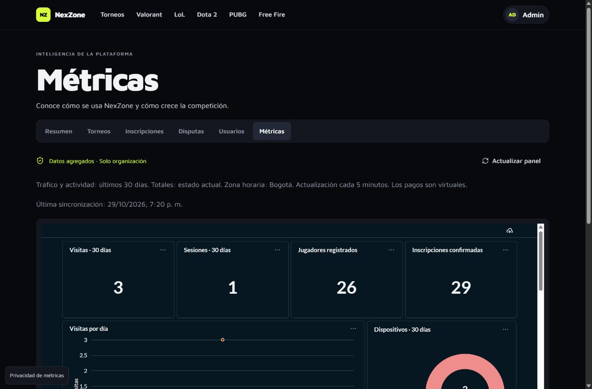

# Métricas web y Metabase



## Estado verificado — 2026-10-29

- Metabase local responde y muestra el formulario de acceso en
  `http://localhost:3001`. Las credenciales se consultan en `.env.metricas`;
  no se incluyen contraseñas reales en esta documentación ni en Git.
- Se comprobaron la sincronización, las 14 preguntas, el aprovisionamiento sin
  duplicados y los permisos de solo lectura del almacén agregado.
- La captura anterior corresponde a la verificación en el navegador integrado.
  **En Chrome se observó el marco de Metabase vacío y su causa sigue pendiente
  de diagnóstico.** No se considera terminada la validación visual en Chrome.
- Los accesos a Organización y Métricas están disponibles en Mi panel para
  administrador y empleado. El error de ruta observado tras actualizar Git se
  resolvió reiniciando Vite, que estaba sirviendo una copia anterior de las rutas.
- Metabase en producción no se desplegó; sus pasos están en
  [despliegue](despliegue.md).

Mientras se resuelve la incrustación en Chrome, acceder directamente a Metabase
y abrir **NexZone · Métricas → NexZone · Métricas de la plataforma**. Un marco
vacío no significa que los indicadores valgan cero ni que falten datos.

## Arranque local

Requisitos: Docker activo, Docker Compose y Node. Desde la raíz:

```bash
node docker/metricas/preparar.mjs
docker compose --env-file .env.metricas -f compose.yaml -f compose.metricas.yaml up -d --build
```

Espera a que Metabase esté sano (`/api/health` devuelve `{"status":"ok"}`).
El primer arranque de la JVM y sus migraciones tarda varios minutos.

```bash
docker compose --env-file .env.metricas -f compose.yaml -f compose.metricas.yaml exec api php artisan metricas:sincronizar
docker compose --env-file .env.metricas -f compose.yaml -f compose.metricas.yaml exec api php artisan metricas:preparar
cd frontend
npm ci
npm run dev
```

Entra en la aplicación en `http://localhost:5173`, con una cuenta de organización,
y abre **Organización → Métricas**. La navegación de **Mi panel** también muestra
accesos directos a **Organización** y **Métricas** para administrador y empleado.
El administrador de Metabase está en
`http://localhost:3001`; sus credenciales aleatorias están exclusivamente en
`.env.metricas`. No son las credenciales del administrador de NexZone.

`preparar.mjs` nunca sobrescribe claves existentes. `metricas:preparar` conserva
los IDs de preguntas y del dashboard al repetirse. Sus preguntas y distribución
son administradas por el código: las personalizaciones manuales de esas mismas
preguntas pueden ser reemplazadas al volver a ejecutar el comando. Crea una copia
en otra colección para análisis propios.

Usa siempre los dos archivos Compose y `--env-file .env.metricas` para gestionar
este conjunto. La base local de la aplicación continúa siendo SQLite.

## Indicadores del panel

| Indicador | Definición |
| --- | --- |
| Visitas | Eventos de navegación aceptados, últimos 30 días de calendario |
| Sesiones diarias acumuladas | UUID de sesión distintos dentro de cada día; sumados por día |
| Jugadores | Cuentas con rol `jugador`, inventario actual |
| Confirmadas | Inscripciones actualmente `aprobada` |
| Visitas por día, página y dispositivo | Conteos de eventos; página es una categoría, no una URL |
| Inscripciones por juego | Total creado y actualmente aprobado, agrupado por juego |
| Registros e inscripciones diarias | Fecha de creación en calendario de Bogotá |
| Estados de inscripción | Inventario actual; no es un embudo de conversión |
| Rendimiento | p75 diario de LCP e INP en milisegundos, CLS sin unidad, con muestras |
| Torneos y cupos | Inventario por juego y estado; cada torneo suma sus cupos una vez |
| Pagos virtuales | Órdenes que siguen `pagada`, agrupadas por `pagada_en`, COP = centavos / 100 |
| Actualización | Momento de la última publicación completa |

La ventana de conservación es de **90 días**; las gráficas muestran **30 días**.
Todos los días se interpretan en `America/Bogota`. El acumulado de sesiones no
es el número de personas únicas del mes. Los dispositivos se clasifican por
ancho de ventana: móvil <768 px, tableta <1024 px y escritorio desde 1024 px;
no se infiere el hardware físico.

Los pagos reembolsados dejan de estar incluidos; el indicador refleja el estado
vigente y no constituye contabilidad histórica. Todos los importes son virtuales.

## Rendimiento correctamente interpretado

Se utiliza `web-vitals`, cargado bajo demanda tras obtener permiso. Las muestras
corresponden a cargas del documento y a su restauración desde bfcache, no a cada
cambio de ruta de React. El p75 usa rango más cercano: ordenar las muestras y
tomar `ceil(n × 0,75)`. Se muestra el número de muestras, no se sustituyen ausencias
por cero ni se promedian percentiles diarios.

Valores orientativos buenos: LCP ≤2500 ms, INP ≤200 ms, CLS ≤0,1. No todos los
navegadores producen todas las métricas; INP requiere interacción. Aceptar la
medición después de cargar puede producir una muestra parcial de esa carga.

## Privacidad y seguridad

- Sin permiso no se envían eventos. Rechazar y aceptar son opciones visibles.
- La preferencia se guarda en `localStorage`; la sesión aleatoria en
  `sessionStorage`, con vencimiento por 30 minutos de inactividad.
- El control **Privacidad de métricas** permite cambiar la preferencia.
- Se respetan Do Not Track y Global Privacy Control en cliente y servidor.
- No se guardan IP, correos, apodos, identificadores de cuenta ni URLs.
- Organización no genera visitas de navegación para evitar contaminar el panel.
- Campos desconocidos se descartan y los campos admitidos se validan.
- Ingesta limitada a 30 peticiones/minuto por IP, además del límite general.
- Escrituras del navegador conservan CSRF; Metabase usa `SELECT` sobre agregados.
- JWT de 10 minutos, sin clave en frontend ni dashboard elegido por el cliente.
- El panel renueva sus datos/token cada cinco minutos mientras está abierto;
  las respuestas de firma llevan `Cache-Control: no-store, private`.
- Las cifras dependen del cliente: no usar esta telemetría para pagos, premios,
  auditoría antifraude ni decisiones de autorización.

Retirar el permiso detiene la captura futura y elimina la sesión de la pestaña.
Los agregados ya publicados no permiten identificar ni borrar una persona
concreta. La revocación del acceso al panel impide obtener nuevos tokens; un token
ya emitido conserva validez hasta su caducidad máxima de diez minutos.

## Tablas y responsabilidades

Fuente operativa: `eventos_metrica` y `configuracion_metricas`. La configuración
guarda el ID del panel y la última sincronización, nunca contraseñas.

Almacén PostgreSQL: `trafico_diario`, `sesiones_diarias`, `rendimiento_diario`,
`actividad_diaria`, `torneos_por_juego`, `inscripciones_por_estado` y
`resumen_plataforma`. No contiene filas individuales de navegación.

Roles: `metricas_escritor` publica y reconstruye; `metricas_lector` solo consulta.
La base `metabase` conserva su catálogo con otro usuario. PostgreSQL no publica
puertos al host; Metabase publica exclusivamente en loopback.

## Operación

El servicio `metricas-planificador` ejecuta el scheduler de Laravel. Cada cinco
minutos llama `metricas:sincronizar`, con protección contra solapamientos.
Una transacción y un bloqueo asesor protegen la publicación. Un error conserva
la última instantánea. La interfaz advierte tras 15 minutos sin sincronizar.

```bash
docker compose --env-file .env.metricas -f compose.yaml -f compose.metricas.yaml ps
docker compose --env-file .env.metricas -f compose.yaml -f compose.metricas.yaml logs --tail 80 metabase metricas-planificador
docker compose --env-file .env.metricas -f compose.yaml -f compose.metricas.yaml exec api php artisan metricas:sincronizar
docker compose --env-file .env.metricas -f compose.yaml -f compose.metricas.yaml exec api php artisan metricas:preparar
```

`down` conserva el volumen. **No usar `down -v`** para un reinicio: borraría la
configuración y los agregados. No regenerar `.env.metricas` con un volumen ya
inicializado: PostgreSQL no cambia contraseñas existentes al cambiar el entorno.
Una rotación exige `ALTER ROLE`, actualizar secretos y recrear los servicios.

Para desactivar captura, establecer `METRICAS_HABILITADAS=false` en el entorno de
la API y del planificador y recrear ambos. La configuración predeterminada sin
el archivo Compose de métricas está deshabilitada.

## Copias y restauración

Conserva una copia de la base operativa, la base `metabase` y `.env.metricas`
cifrada por separado. Los agregados pueden reconstruirse de la fuente vigente.
Ejecutar desde una terminal Bash/WSL, redirigiendo fuera del repositorio:

```bash
docker compose --env-file .env.metricas -f compose.yaml -f compose.metricas.yaml exec -T metricas-db pg_dump -U metabase -d metabase -Fc > /ruta/privada/metabase.dump
```

Restaurar el dump sobre una base vacía de la misma versión mayor de PostgreSQL,
usando `pg_restore --exit-on-error` y credenciales administrativas; conservar la
clave `METABASE_ENCRYPTION_SECRET_KEY`, porque cifra la conexión de lectura.
Después, sincronizar y verificar preguntas, permisos y firma del panel. No
restaurar sobre la base operativa de torneos.

## Versiones y problemas frecuentes

La configuración para un clon nuevo fija Metabase `v0.64.3` y PostgreSQL `17.10`.
El entorno local dispone de opciones `METABASE_IMAGEN`,
`METRICAS_IMAGEN_POSTGRES` y `METRICAS_IMAGEN_PHP` para fijar imágenes ya
instaladas. Esta sesión utilizó Metabase `v0.62.3.6`, PostgreSQL `17.10` y PHP
`8.5.10` debido a descargas truncadas del registro. Antes de publicar, actualizar
a una versión soportada y ejecutar de nuevo la verificación; no se da por probada
una imagen que no pudo descargarse.

| Síntoma | Comprobación y solución |
| --- | --- |
| Metabase iniciando | Revisar `logs`; esperar migraciones y `/api/health` sano |
| Panel sin configurar | Ejecutar `metricas:preparar` con el entorno correcto |
| La ruta muestra «Esta página no existe» tras actualizar Git | Comprobar que se sirve este checkout; detener Vite y volver a ejecutar `npm run dev` si mantiene las rutas anteriores |
| La ruta abre, pero el marco de Metabase queda vacío en Chrome | Incidencia pendiente de diagnóstico; usar el acceso directo en `http://localhost:3001`. No considerar aprobada la integración visual en ese navegador |
| No se ve tráfico | Aceptar métricas, navegar y sincronizar; DNT/GPC o bloqueadores pueden impedir captura |
| Rendimiento sin muestras | Interactuar y ocultar la pestaña; comprobar soporte del navegador |
| Error de firma | API y Metabase deben compartir `METABASE_SECRET_KEY` |
| Datos viejos | Revisar scheduler y conexión PostgreSQL; reejecutar sincronización |
| Descarga cortada | Reintentar con conectividad estable o una imagen fijada disponible; no cambiar versiones de producción sin prueba |
| Puerto ocupado | Cambiar `METABASE_PORT`, recrear y verificar URL/orígenes |
| Claves nuevas y volumen antiguo | Restaurar las claves originales o hacer rotación coordinada |

Referencias: [guest embeds](https://www.metabase.com/docs/latest/embedding/guest-embedding),
[Docker](https://www.metabase.com/docs/latest/installation-and-operation/running-metabase-on-docker),
[API](https://www.metabase.com/docs/latest/api-documentation),
[web-vitals](https://github.com/GoogleChrome/web-vitals).
